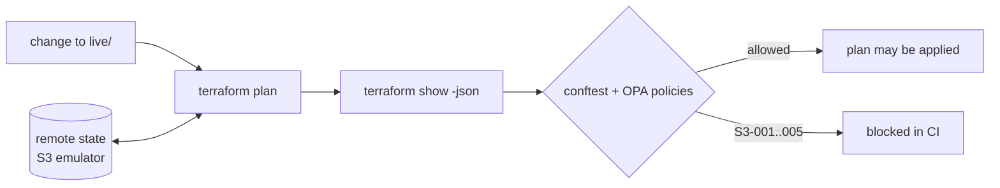

# terraform-policy-demo

A sample **versioned Terraform module** (a secure S3 bucket), **OPA policies that run against the plan in CI**
(one change that passes, one that is blocked), **`terraform test`** for the module, and **remote state in an
S3 bucket on a local emulator**, so no cloud account is needed.

> **Honest scope:** this is a learning and portfolio project. There is **no real AWS account**: every "bucket"
> lives in a local S3 emulator ([moto](https://github.com/getmoto/moto)) that keeps its data in memory and
> forgets it on restart. It has no real users and makes no production claims. The emulator is not AWS, so
> behavior that depends on real IAM, KMS, replication or eventual consistency is not exercised.

## Contents

- [What it does](#what-it-does)
- [How it works](#how-it-works)
- [What this project demonstrates](#what-this-project-demonstrates)
- [Quick start](#quick-start)
- [The policies](#the-policies)
- [Module versioning](#module-versioning)
- [Trying it on real AWS (untested)](#trying-it-on-real-aws-untested)
- [Project layout](#project-layout)
- [Known limits](#known-limits)

## What it does

`modules/s3-bucket` creates a private, versioned, encrypted bucket with required `Owner` and `Environment` tags.
`live/` uses it and stores its state remotely. CI then proposes two changes to that live configuration and runs
the policies on each plan:

| Change | What it does | Plan | Policy |
|---|---|---|---|
| **allowed** | adds a 30-day object expiry and a `CostCenter` tag | update bucket, create lifecycle rule | passes |
| **blocked** | sets `block_public_access = false` | update public access block | rejected by `S3-001` |

The module deliberately lets a caller turn the public access block off: a validation rule can't know the
organization's policy. The OPA check is the second layer that stops it before it is applied.

## How it works



The plan runs against a real baseline: CI first applies the baseline to the emulator (state written to
`s3://tf-state/...`), so the two plans show genuine in-place updates, not just creates.

## What this project demonstrates

- **A versioned module** with typed, validated inputs, secure defaults, outputs, a changelog and semver rules.
- **Policy-as-code on the plan**, not the source: OPA/Rego rules read `terraform show -json`, so they judge what
  Terraform is actually about to do, including changes made through a module.
- **Allowed and blocked paths both tested.** The CI script fails if the blocked change is *not* blocked, or is
  blocked by the wrong rule. The policies also have their own unit tests (`conftest verify`).
- **`terraform test`** for the module: secure defaults, tag precedence, optional lifecycle rule, input
  validation (`expect_failures`), run against a mocked provider so it needs no emulator.
- **Remote state with native S3 locking** (`use_lockfile`, no DynamoDB) against a local S3 emulator. A planted
  lock file made `terraform plan` fail with `PreconditionFailed`, so the emulator enforces the lock.

## Quick start

Needs [Terraform](https://developer.hashicorp.com/terraform) 1.10+ (tested on 1.16.4),
[conftest](https://www.conftest.dev) and [uv](https://docs.astral.sh/uv/).

```bash
uv sync
make ci              # fmt, validate, terraform test, OPA tests, version check, then the policy demo
```

Or one piece at a time:

```bash
make test-module     # terraform test (mocked provider)
make test-policy     # conftest verify: unit tests for the Rego rules
make policy-demo     # starts the emulator, applies the baseline, plans both changes, runs the policies
make clean           # stop the emulator, remove plan files
```

## The policies

`policy/s3.rego`, evaluated by `conftest test` against the plan JSON. Rules only judge resources the plan
changes; an untouched legacy bucket is not this change's problem.

| Rule | Denies |
|---|---|
| `S3-001` | any public access setting that is not `true` |
| `S3-002` | a changed bucket with no server-side encryption configured alongside it |
| `S3-003` | a changed bucket missing a non-blank `Owner` or `Environment` tag |
| `S3-004` | `force_destroy = true` on a bucket tagged `prod` |
| `S3-005` | destroying a bucket |

## Module versioning

`modules/s3-bucket` follows semver, documented in its [`CHANGELOG.md`](modules/s3-bucket/CHANGELOG.md). The
version is set once in `main.tf`, written to every bucket's `ModuleVersion` tag, and released as the git tag
`s3-bucket/vX.Y.Z`. CI fails if `main.tf` and the changelog disagree. Consumers pin a tag:

```hcl
source = "git::https://github.com/miguelmora76/terraform-policy-demo.git//modules/s3-bucket?ref=s3-bucket/v1.0.0"
```

`live/` uses a relative path so the demo changes and the module move together.

## Trying it on real AWS (untested)

**None of this has been run.** There is no AWS account behind this project; the steps below are what I would
do, and they are the honest list of what the emulator does *not* prove. Use a throwaway sandbox account, never a
shared or production one, and set a budget alert first.

**1. Credentials.** Use short-lived credentials: `aws sso login --profile sandbox && export AWS_PROFILE=sandbox`
locally, and GitHub OIDC in CI (step 7). No long-lived access keys, and the fake `test`/`test` keys must not be
used.

**2. Create the state bucket once, outside Terraform** (a backend can't create its own bucket). Pick a globally
unique name:

```bash
BUCKET=my-unique-tf-state-bucket; REGION=us-east-1
aws s3api create-bucket --bucket "$BUCKET" --region "$REGION"   # outside us-east-1 add --create-bucket-configuration LocationConstraint=$REGION
aws s3api put-bucket-versioning --bucket "$BUCKET" --versioning-configuration Status=Enabled
aws s3api put-bucket-encryption --bucket "$BUCKET" --server-side-encryption-configuration \
  '{"Rules":[{"ApplyServerSideEncryptionByDefault":{"SSEAlgorithm":"AES256"}}]}'
aws s3api put-public-access-block --bucket "$BUCKET" --public-access-block-configuration \
  BlockPublicAcls=true,IgnorePublicAcls=true,BlockPublicPolicy=true,RestrictPublicBuckets=true
```

**3. Point the backend at it.** Add `live/backend.aws.hcl` and use it instead of `backend.local.hcl`. There is no
`endpoints`, no keys and no `skip_*` flags:

```hcl
bucket       = "my-unique-tf-state-bucket"
key          = "terraform-policy-demo/live.tfstate"
region       = "us-east-1"
encrypt      = true
use_lockfile = true   # native S3 locking; needs no DynamoDB table
```

**4. Change the provider block in `live/main.tf`.** Remove `access_key`, `secret_key`, every `skip_*` flag,
`s3_use_path_style` and the `endpoints` block, and delete the `s3_endpoint` variable. What is left is
`provider "aws" { region = "us-east-1" }`; credentials come from the environment.

**5. Make the bucket name unique.** S3 names are global. `demo-app-logs` in `live/main.tf` will almost certainly be
taken, so use something like `demo-app-logs-<account-id>`. Both the module and the policies are name-agnostic.

**6. Give the identity the permissions it needs** (a least-privilege role, not `AdministratorAccess`):

| Where | Actions |
|---|---|
| State bucket | `s3:ListBucket`, and `s3:GetObject`, `s3:PutObject`, `s3:DeleteObject` on the state key and its `.tflock` file |
| Demo bucket | `s3:CreateBucket`, `s3:DeleteBucket`, `s3:ListBucket`, `s3:GetBucket*`, `s3:PutBucketTagging`, `s3:PutBucketVersioning`, `s3:PutEncryptionConfiguration`, `s3:PutBucketPublicAccessBlock`, `s3:PutLifecycleConfiguration` |

**7. Adapt the pipeline.** `scripts/check_policy.sh` applies the baseline on every run, which is right for an
emulator that starts empty and wrong for a real account. For AWS, split it:

- *Pull request:* `terraform init -backend-config=backend.aws.hcl`, then **plan only**, `terraform show -json`, then
  `conftest test`. Never apply from a PR. Authenticate with `aws-actions/configure-aws-credentials` using
  `role-to-assume` and `permissions: id-token: write` (an IAM role that trusts GitHub's OIDC provider for this repo).
- *Merge to `main`:* apply the reviewed plan, ideally behind a GitHub Environment with required reviewers.
- Keep `terraform test` as it is; it uses a mocked provider and needs no credentials.

**8. Run it once by hand before wiring CI.**

```bash
cd live
terraform init -backend-config=backend.aws.hcl
terraform apply                                   # the baseline bucket
terraform plan -var-file=changes/allowed.tfvars -out=a.tfplan && terraform show -json a.tfplan > a.json
conftest test a.json -p ../policy                 # expect: pass
terraform plan -var-file=changes/blocked.tfvars -out=b.tfplan && terraform show -json b.tfplan > b.json
conftest test b.json -p ../policy                 # expect: S3-001 failures; do NOT apply b.tfplan
```

**9. Check what the emulator could not.** Confirm real AWS state matches what the module claims:
`aws s3api get-bucket-encryption`, `get-public-access-block`, `get-bucket-versioning`, `get-bucket-tagging` and
`get-bucket-lifecycle-configuration` on the demo bucket, and that the state object and (during a run) its `.tflock`
exist in the state bucket. Also confirm the plan JSON from real AWS has the same shape the Rego rules expect. The
rules were written against emulator plans, which come from the same provider, so I expect no difference, but that is
an expectation, not a result.

**10. Clean up.** `S3-005` blocks destroying a bucket, but only in CI on a plan, so a local
`terraform destroy` still works (empty the bucket first, since `force_destroy` is off). Then delete the state
bucket by hand, remove its versions as well, and delete the IAM role. Everything here costs cents at most, but
versioned buckets keep old objects until they are removed.

## Project layout

```
modules/s3-bucket/   main/variables/outputs/versions.tf, CHANGELOG.md, tests/*.tftest.hcl
live/                root config using the module; backend.local.hcl; changes/allowed.tfvars, blocked.tfvars
policy/              s3.rego and s3_test.rego
scripts/             emulator.sh, check_policy.sh, check_changelog.sh
.github/workflows/   ci.yml
```

## Known limits

- No real AWS account; a local emulator stands in, and the "remote" state is on localhost, in memory. See
  [Trying it on real AWS](#trying-it-on-real-aws-untested) for what testing it for real would take.
- The emulator doesn't evaluate IAM or KMS, and the module uses AES256 only (no customer-managed keys).
- Five small rules for one resource family. A real guardrail set would be broader and would load organization
  data (exemptions, allowed regions) instead of hard-coding.
- The S3-002 check matches an encryption resource to a bucket by module address, not by resource reference.
  It catches a bucket created with no encryption alongside it, not a mismatched pairing within one module.
- The blocked change is a plan only, never applied. There is no apply-on-merge pipeline, and no
  Terratest-style (Go) integration test; `terraform test` covers the module.
- Fake credentials (`test`/`test`) are committed on purpose; they only work against the emulator.
